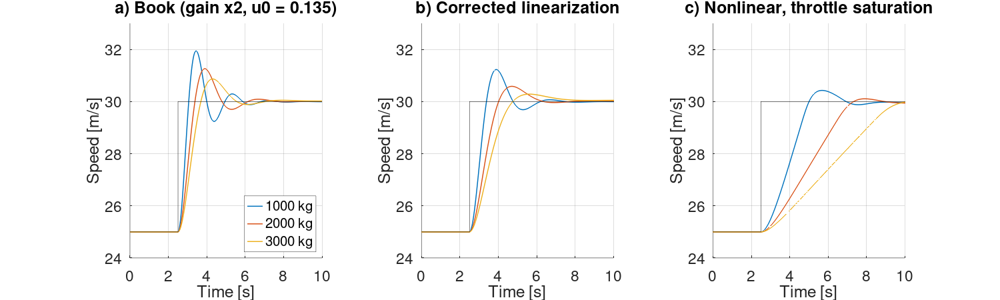
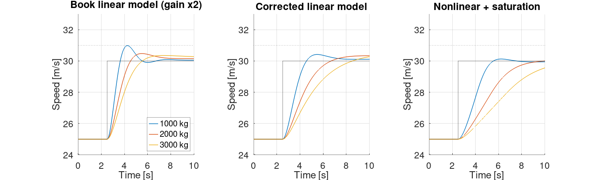
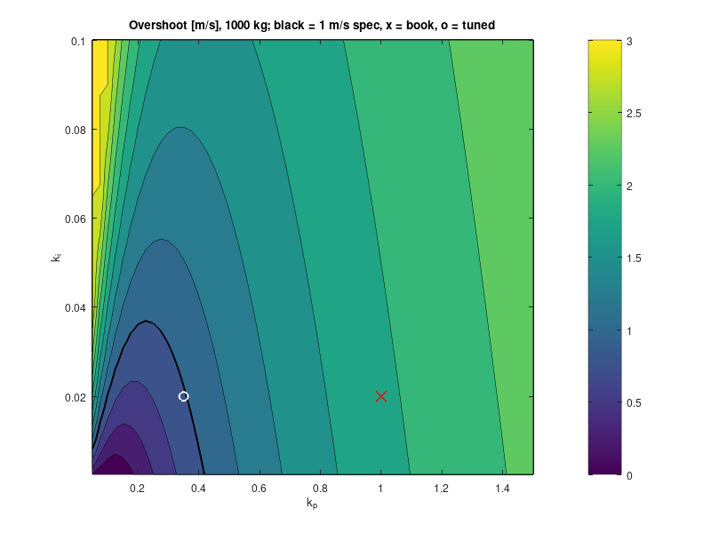

# ECE-340 Week 01 — Cruise Control

## Objectives

- Read Chapter 1 and identify the sense–compute–actuate loop in the cruise
  control example (Figure 1.13, p. 18).
- Build the §3.1 vehicle model from first principles in GNU Octave instead of
  running the companion-site MATLAB code as provided.
- Reproduce Figure 1.13, then do **Exercise 1.4** (p. 26): retune the controller
  so the speed overshoots by no more than 1 m/s for a 1000 kg car.
- Check the new design against heavier cars and against the full nonlinear model
  with throttle saturation.

## What Was Built

| File | Purpose |
| --- | --- |
| [`cruise_params.m`](cruise_params.m) | Vehicle, engine, and drag parameters from §3.1 |
| [`cruise_accel.m`](cruise_accel.m) | Nonlinear vehicle dynamics, equation (3.3), with the torque curve (3.2) |
| [`cruise_linearize.m`](cruise_linearize.m) | Trim throttle and central-difference linearization `b / (s - a)` about a speed |
| [`cruise_pi.m`](cruise_pi.m) | PI controller with low-frequency pole and 2/(s+2) engine lag, as in the companion code |
| [`cruise_closed_loop.m`](cruise_closed_loop.m) | State-space matrices of the linearized closed loop |
| [`cruise_step_linear.m`](cruise_step_linear.m) | Exact (ZOH, `expm`) 25 → 30 m/s step response of the linear loop |
| [`cruise_step_nonlinear.m`](cruise_step_nonlinear.m) | Same step on the nonlinear vehicle with throttle saturation and conditional-integration anti-windup |
| [`cruise_fig113.m`](cruise_fig113.m) | Reproduces Figure 1.13 and compares it with a corrected linearization and the nonlinear model → `cruise_fig113.png` |
| [`cruise_tune.m`](cruise_tune.m) | Exercise 1.4: grid search over (k_p, k_i), pole check, and robustness check → `cruise_tune.png`, `cruise_tune_map.png` |



### Results

Figure 1.13 reproduction, k_p = 1, k_i = 0.02, overshoot in m/s:

| Model | 1000 kg | 2000 kg | 3000 kg |
| --- | --- | --- | --- |
| (a) Book linearization (matches the printed figure) | 1.94 | 1.26 | 0.87 |
| (b) Corrected linearization | 1.23 | 0.58 | 0.28 |
| (c) Nonlinear, throttle saturated to [0, 1] | 0.43 | 0.11 | 0.01 |

Exercise 1.4 design on model (a): **k_p = 0.35, k_i = 0.02**. The search picks
the fastest 2%-settling design with overshoot ≤ 1 m/s. That is the book's k_i
with k_p cut from 1 to 0.35. Overshoot in m/s:

| Model | 1000 kg | 2000 kg | 3000 kg |
| --- | --- | --- | --- |
| (a) Book linearization | 0.98 | 0.47 | 0.35 |
| (b) Corrected linearization | 0.41 | 0.33 | 0.46 |
| (c) Nonlinear + saturation | 0.12 | 0.05 | 0.11 |

Closed-loop poles at 1000 kg move from −1.00 ± 3.34j (ζ ≈ 0.29) to
−0.98 ± 1.80j (ζ ≈ 0.48), with a slow integrator pole near the origin.




## Key Concepts

- **Figure 1.13 is a linear simulation.** The companion script
  `intro/cruise_response.m` linearizes the §3.1 model in **gear 3** about
  25 m/s, adds a first-order engine lag `2/(s+2)`, and closes the loop with
  `C(s) = (k_p s + k_i)/(s + 0.01 k_i/k_p)` using k_p = 1, k_i = 0.02. No
  throttle saturation is simulated. The figure's 25–30 m/s step comes from
  scaling a unit step response by 5.
- **The companion code doubles the plant gain.** Its throttle derivative is a
  central difference over ±0.01 that divides by 0.01, not 0.02. It also uses a
  fixed trim throttle of 0.135 for every mass; that is correct only for
  1000 kg (2000 kg needs 0.167, and 3000 kg needs 0.200). Panel (a) keeps both
  choices to match the printed curves. Panel (b) corrects them, and every
  overshoot drops.
- **With engine lag, more k_p means more overshoot.** If the vehicle alone is
  modeled as a first-order plant, raising k_p only adds damping. The engine lag
  makes the loop third order, so raising k_p pushes crossover into the lag's
  phase loss. The overshoot map shows that only k_p ≲ 0.4 meets the spec at any
  k_i. Week 10 (stability margins) explains this formally.
- **Lighter cars overshoot more** because the plant gain `b` scales as 1/m. The
  same controller gives a higher loop gain on a light car.
- **Saturation dominates large steps.** A 5 m/s step asks for k_p·5 = 5 units of
  throttle against a 0–1 range, so the nonlinear car accelerates at full
  throttle and overshoots far less than either linear model predicts. The
  heavier cars become acceleration-limited, not damping-limited.
- **Anti-windup choice matters.** Back-calculation with a 1 s tracking time
  drove the controller state far negative during saturation. With k_i = 0.02
  it then took more than 20 s to recover, and the car stalled near 28.5 m/s.
  Conditional integration (freezing the integrator while saturated) fixed it.
  Chapter 10 §10.4 covers this properly.
- **The integral tail is slow.** With k_i = 0.02 the integrator pole sits near
  −0.02 to −0.06 rad/s. The heavier cars therefore sit a few tenths of a m/s
  off the setpoint for tens of seconds after the step, and a 2% settling
  criterion catches this where a 5% one does not.

## Build and Run

This week is simulation-only. Run from this directory with GNU Octave (tested on
Octave 11.3; no packages required):

```bash
cd ECE-340_Feedback-Systems/Week01-Cruise-Control
octave --no-gui --quiet cruise_fig113.m   # Figure 1.13 reproduction
octave --no-gui --quiet cruise_tune.m     # Exercise 1.4 tuning
```

Each script prints its overshoot tables to the console and writes its PNG plots
into this directory.

## References

- Åström & Murray, *Feedback Systems*, §1.4 and Figure 1.13 (pp. 17–18),
  Exercise 1.4 (p. 26), and §3.1 Cruise Control (pp. 65–69).
- Companion sources:
  [`intro/cruise_response.m`](http://www.cds.caltech.edu/~murray/books/AM05/matlab/intro/cruise_response.m)
  and [`cruisedyn.m`](http://www.cds.caltech.edu/~murray/books/AM05/matlab/cruisedyn.m).
  These were read for comparison and are not copied here.
- [`ECE-340_Feedback-Systems_Syllabus.md`](../ECE-340_Feedback-Systems_Syllabus.md)
  for the course reading and lab sequence.
- See [ECE-340_References.md](../ECE-340_References.md) for download links.

## AI Assistance

Claude Code wrote the Octave model and scripts from a maintainer-supplied
walkthrough, checked them against the book text and the companion-site MATLAB
code, and drafted this README. Reviewed and edited by the maintainer.
